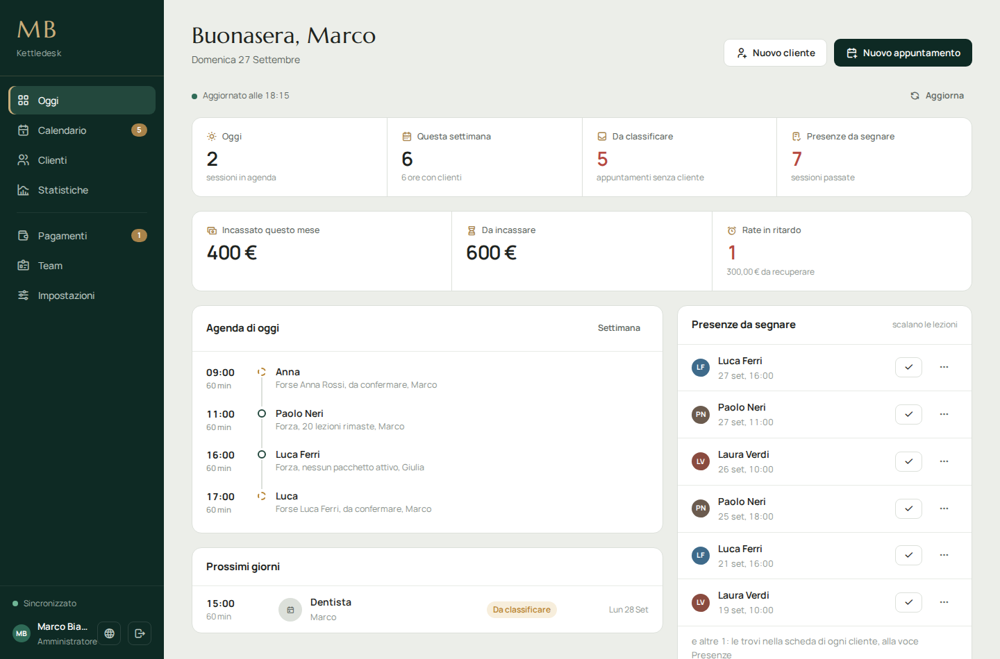
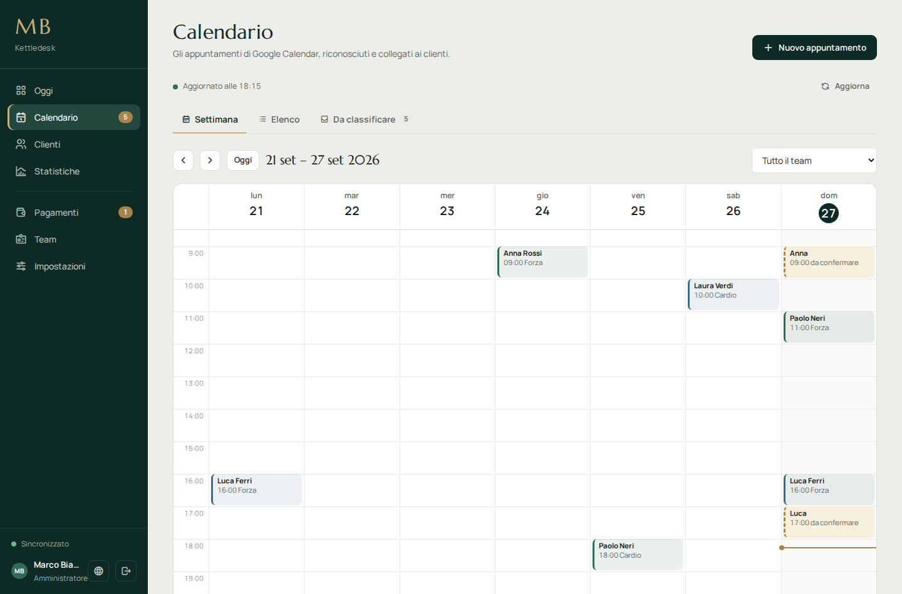
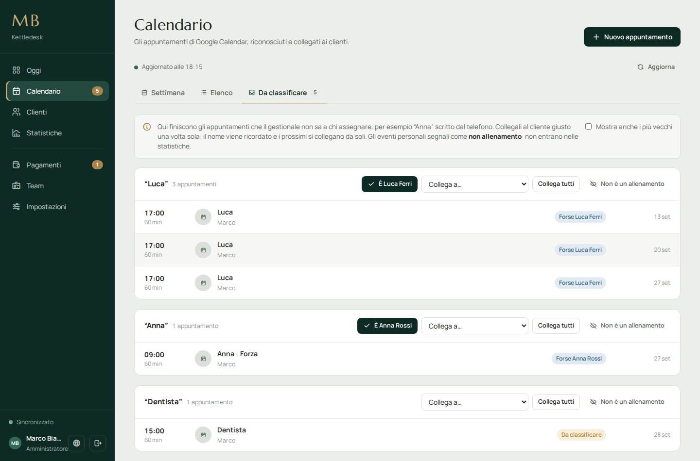
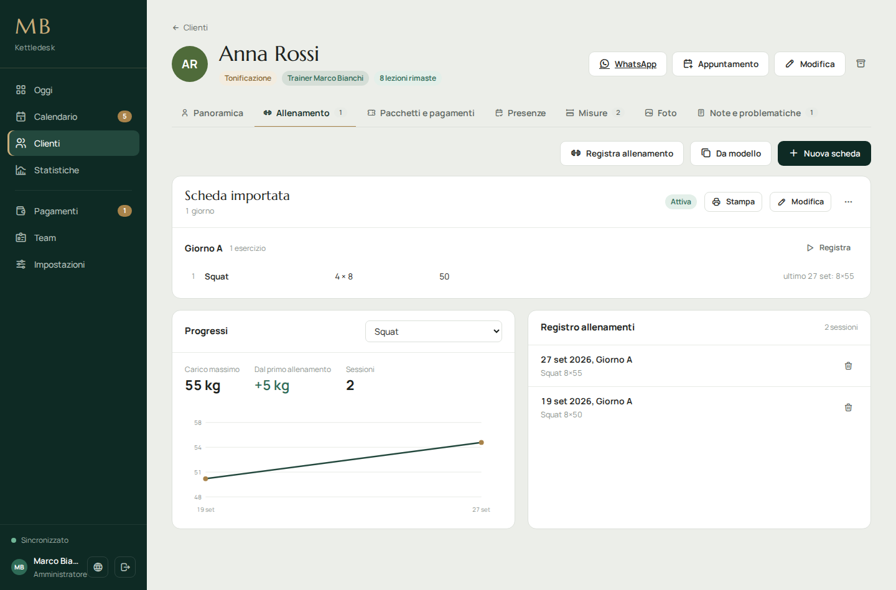
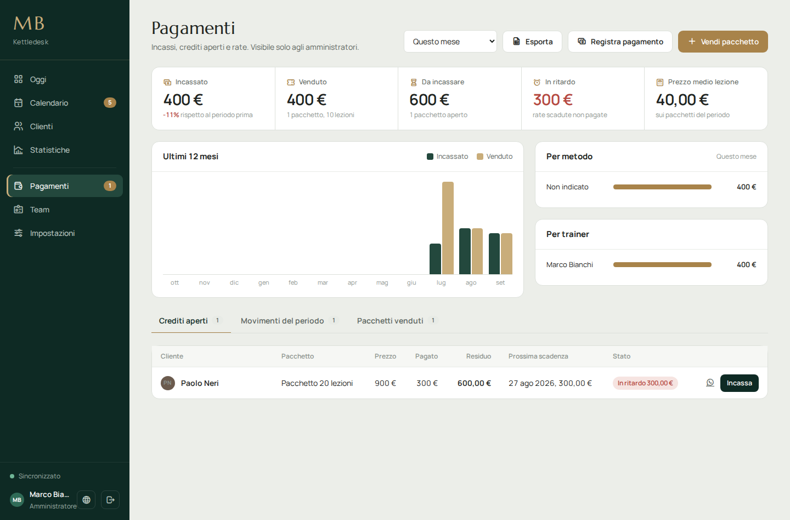

<div align="center">

# Kettledesk

**Il gestionale per personal trainer che segnano i clienti dal telefono.**

Clienti, appuntamenti, pacchetti, pagamenti e schede di allenamento in un'unica app desktop.
Google Calendar resta la tua agenda; i dati restano cifrati sul tuo computer.

[](LICENSE)


[English](README.md) | **Italiano**



</div>

## Perché esiste

La maggior parte dei software per personal trainer è pensata per il coaching online: vuole un abbonamento, un server e i dati dei clienti sul cloud di qualcun altro.
Kettledesk nasce per uno studio vero, che lavora in un altro modo:

- **Gli appuntamenti si segnano dal telefono**, su Google Calendar, spesso solo con il nome ("Anna"). Il gestionale capisce chi è "Anna", chiede una volta sola quando non è sicuro e si ricorda la risposta.
- **Gli impegni personali restano fuori dai numeri.** Dentista, cena, compleanno: un clic li segna come "non è un allenamento" e non entrano mai nelle statistiche.
- **Le lezioni si vendono a pacchetti.** Ogni presenza scala una lezione, e volendo anche le disdette tardive. I pacchetti si possono pagare a rate, e quelle in ritardo vengono segnalate.
- **Nessun server, nessun abbonamento.** È un'app desktop. I dati stanno sul PC dello studio, cifrati, con backup in una cartella a scelta.

## Funzioni

| | |
|---|---|
| **Calendario** | Vista settimana ed elenco sopra Google Calendar. Crea, modifica ed elimina appuntamenti; funziona anche offline e sincronizza al ritorno della connessione. |
| **Riconoscimento degli appuntamenti** | Collega i titoli ai clienti per nome e cognome, cognome e nome o nomi memorizzati. I titoli non riconosciuti finiscono in *Da classificare*, raggruppati per nome, così ognuno si sistema una volta sola. Le serie ricorrenti si collegano in un colpo. |
| **Clienti** | Anagrafica, problematiche con priorità, note, misure con grafici, foto dei progressi cifrate con confronto affiancato, archivio. |
| **Presenze** | Presente, assente, disdetta tardiva. Le presenze scalano le lezioni dal pacchetto in corso. |
| **Pacchetti e pagamenti** | Listino, vendita con pagamento intero, acconto o rate (mensili o ogni due settimane), crediti aperti, rate in ritardo, promemoria WhatsApp, ricevute stampabili, esportazione CSV. |
| **Schede di allenamento** | Schede su più giorni con serie, ripetizioni, carico, recupero e note tecniche. Modelli riutilizzabili, stampa con colonne per quattro settimane, registro degli allenamenti con i valori dell'ultima volta già compilati, grafico dei progressi per esercizio. |
| **Statistiche** | Ore, sessioni, costanza, tipi di allenamento, giorni e fasce orarie più piene, andamento su 12 mesi, clienti da ricontattare, pacchetti da rinnovare, confronto del team. |
| **Team** | Amministratori e trainer. I trainer vedono solo i propri clienti e appuntamenti, mai prezzi e pagamenti. |
| **Lingue** | Italiano, English, Deutsch, Français, Español, Português, 中文, Shqip. Date, numeri e valuta seguono la lingua scelta. |

## Schermate

| | |
|---|---|
|  |  |
| Vista settimana: clienti riconosciuti nel colore del trainer, tratteggiati quando serve una conferma. | *Da classificare*: appuntamenti raggruppati per titolo, collegati una volta e ricordati. |
|  |  |
| Scheda, registro degli allenamenti e progressi di un esercizio. | Incassato, venduto, da incassare e in ritardo, con il controllo delle rate. |

## Per iniziare

### Requisiti

- Windows 10 o 11
- [Node.js](https://nodejs.org) LTS (22 o 24), solo per compilare
- Un account Google e un progetto Google Cloud (gratuito)

### Compilazione

```bash
git clone https://github.com/Mariglend/kettledesk.git
cd kettledesk
npm install
npm start          # avvio in sviluppo
npm run build      # crea dist/Kettledesk.exe (portabile, senza installazione)
```

Su Windows puoi anche fare doppio clic su `BUILD.bat`. La prima volta Windows può mostrare "Windows ha protetto il PC", perché l'eseguibile non è firmato: scegli *Ulteriori informazioni → Esegui comunque*.

<details>
<summary>Problemi di compilazione</summary>

- **"Electron failed to install correctly"**: il download di Electron si è interrotto. Usa Node LTS, controlla che l'antivirus non lo blocchi, cancella `node_modules\electron` e rilancia `npm install`.
- **"Impossibile accedere al file. Il file è utilizzato da un altro processo"**: è ancora aperta una copia dell'app, oppure la cartella `dist` è bloccata. Chiudi l'app o compila in un'altra cartella: `npx electron-builder --win portable -c.directories.output=release`.

</details>

### Collegare Google (una volta sola)

1. Su [Google Cloud Console](https://console.cloud.google.com) crea un progetto.
2. In **API e servizi → Libreria** abilita **Google Calendar API**.
3. In **Schermata consenso OAuth** scegli *Esterno* e aggiungi in **Utenti di test** le email dell'amministratore e dei trainer.
4. In **Credenziali** crea un **ID client OAuth** di tipo **App desktop**.
5. Avvia l'app e incolla il Client ID. Il Client Secret serve solo per i client di tipo *Applicazione web*.

Il primo account che accede diventa amministratore. Gli altri trainer si aggiungono in **Team**: solo le email in elenco possono entrare.
Per vedere gli appuntamenti di un trainer, il trainer condivide il proprio Google Calendar con l'amministratore ("Apporta modifiche agli eventi") e l'amministratore inserisce l'indirizzo di quel calendario in **Team**.

Nome dello studio, valuta e prefisso telefonico predefinito si impostano in **Impostazioni → Studio**. Il nome dello studio compare nel menu, nella schermata di accesso e sulle stampe.

## Come vengono riconosciuti gli appuntamenti

Il titolo dell'evento ha la forma `Nome - Tipo`, per esempio `Anna Rossi - Forza`; il tipo è facoltativo. Un appuntamento viene collegato a un cliente quando, in quest'ordine:

1. è stato collegato a mano, sul singolo evento o su tutta la serie;
2. è stato creato dal gestionale, che salva il cliente nell'evento;
3. il titolo corrisponde a nome e cognome, cognome e nome o a uno dei nomi memorizzati del cliente;
4. il titolo è solo un nome o un cognome che corrisponde a un unico cliente: in questo caso viene *proposto* e basta un clic per confermare.

Gli eventi di tutto il giorno e i titoli segnati come "non è un allenamento" vengono ignorati. Tutto il resto finisce in **Calendario → Da classificare**. Collegando un titolo da lì, il nome viene memorizzato per quel cliente e i prossimi appuntamenti si collegano da soli. Se rinomini un cliente, il vecchio nome continua a essere riconosciuto.

## Dati e privacy

- I dati sono in `%APPDATA%\kettledesk\data\`, cifrati con la protezione dati di Windows (DPAPI, tramite `safeStorage` di Electron): li può leggere solo l'utente Windows che usa l'app.
- Le foto sono file separati, ridimensionate e cifrate.
- Token di Google e password restano nello stesso archivio cifrato. Dal computer escono solo le chiamate a Google per l'accesso e per il calendario.
- L'app è pensata per un PC condiviso dallo studio: ognuno accede con il proprio account Google e vede i dati in base al ruolo.

L'app conserva dati sanitari dei clienti (problematiche, misure, foto). Chi la usa è titolare del trattamento: deve informare i clienti, raccogliere il consenso dove richiesto (GDPR) e proteggere i backup con una password.

## Backup

In **Impostazioni → Backup e sicurezza** scegli una cartella (OneDrive, Google Drive o una chiavetta vanno benissimo). Il backup si aggiorna dopo ogni modifica e contiene:

- `kettledesk-data.json`, tutti i dati per il ripristino;
- `clienti.csv` e `pagamenti.csv` per Excel, senza dati sanitari;
- `foto\` e una copia al giorno in `storico\`.

Con la password del backup, file dati e foto vengono cifrati con AES-256-GCM. Senza la password il backup non si può ripristinare.

## Lingue

L'interfaccia è disponibile in 8 lingue. Al primo avvio segue la lingua del computer; si cambia dalla schermata di accesso, con il pulsante del mappamondo in basso nella barra laterale o in **Impostazioni → Studio**.

Tipi di allenamento, metodi di pagamento predefiniti ed elenco esercizi vengono creati nella lingua in uso alla prima configurazione; da quel momento sono dati tuoi e puoi rinominarli come vuoi.

Le traduzioni sono in [`js/i18n/`](js/i18n). Correzioni e nuove lingue sono benvenute: vedi [CONTRIBUTING.md](CONTRIBUTING.md).

## Struttura del progetto

```
main.js          processo principale Electron: finestra, accesso Google, archivio cifrato, backup
preload.js       ponte tra Electron e l'interfaccia
index.html       struttura della pagina
css/app.css      stile
js/
  i18n.js        funzioni di traduzione ed elenco lingue
  i18n/*.js      un file per lingua
  core.js        utilità, navigazione, finestre, formati
  store.js       dati, salvataggio, pacchetti e presenze
  google.js      accesso, sincronizzazione con Google Calendar, coda offline
  events.js      riconoscimento e collegamento degli appuntamenti
  calendar.js    calendario e "Da classificare"
  clients.js     clienti, misure, foto, note
  money.js       pacchetti, pagamenti, rate, ricevute
  programs.js    schede di allenamento, registro, progressi
  stats.js       statistiche
  dashboard.js   pagina "Oggi"
  admin.js       team, impostazioni, backup
  boot.js        avvio
vendor/          font e icone inclusi, così l'app funziona anche offline
scripts/         controllo delle traduzioni
```

Nessun framework né passaggio di build per l'interfaccia: file JavaScript caricati in ordine da `index.html`.

## Limiti noti

- Compilazione e test riguardano Windows. Electron funziona anche su macOS e Linux, ma configurazione di build e archivio cifrato sono stati usati solo su Windows.
- Serve Google Calendar: non c'è un calendario interno.
- Uno studio per installazione, su un computer. Tra computer diversi non c'è sincronizzazione, se non ripristinando un backup.
- Le ricevute non sono documenti fiscali.

## Licenza

[MIT](LICENSE) © Mariglend Allushi.
I font ([Manrope](https://github.com/sharanda/manrope), [Marcellus](https://fonts.google.com/specimen/Marcellus)) sono sotto SIL Open Font License; le icone sono [Tabler Icons](https://tabler.io/icons) (MIT). Dettagli in [vendor/LICENSES.md](vendor/LICENSES.md).
