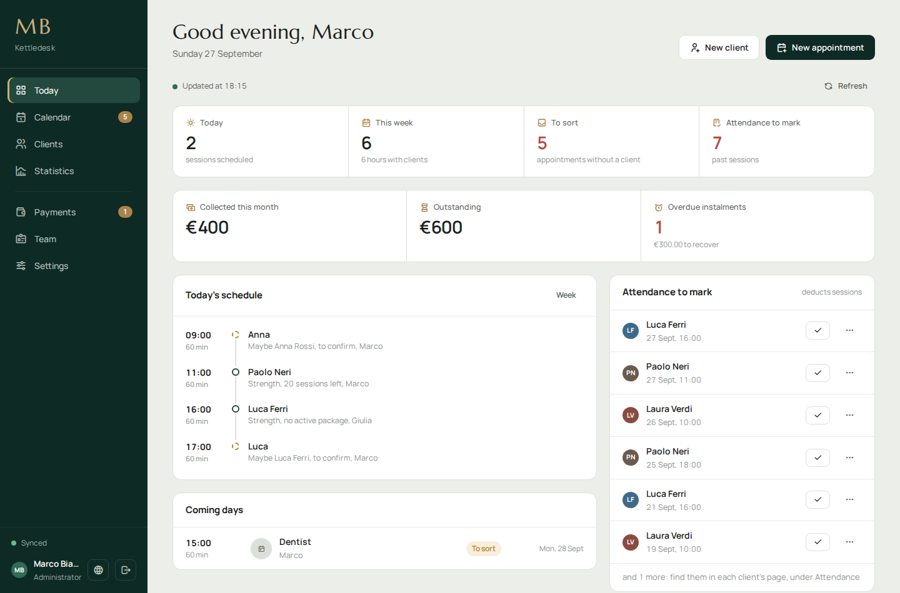
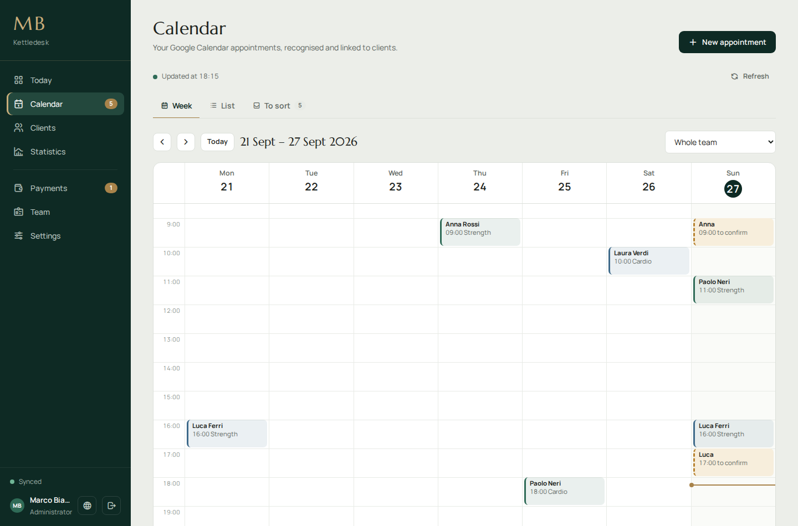
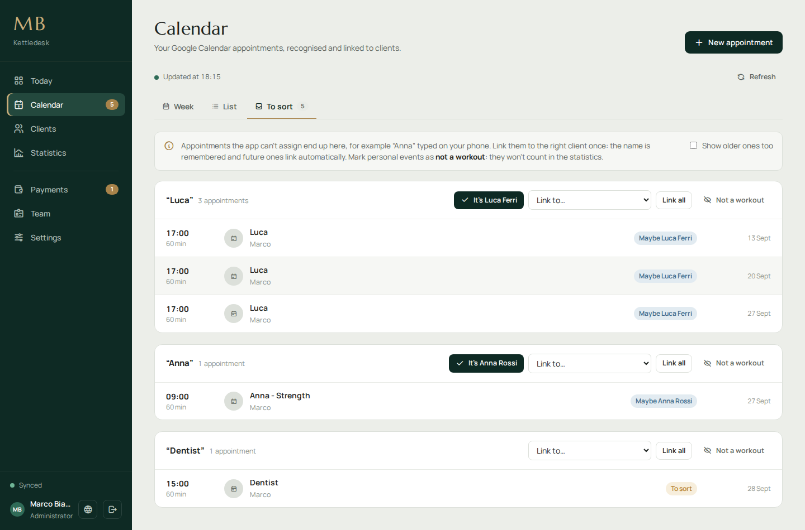
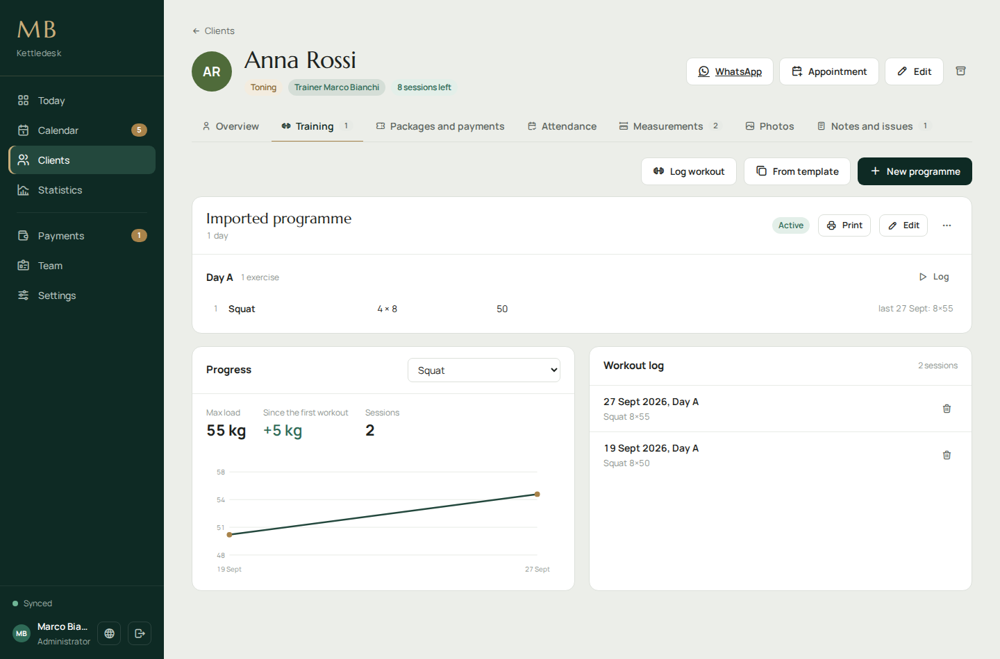
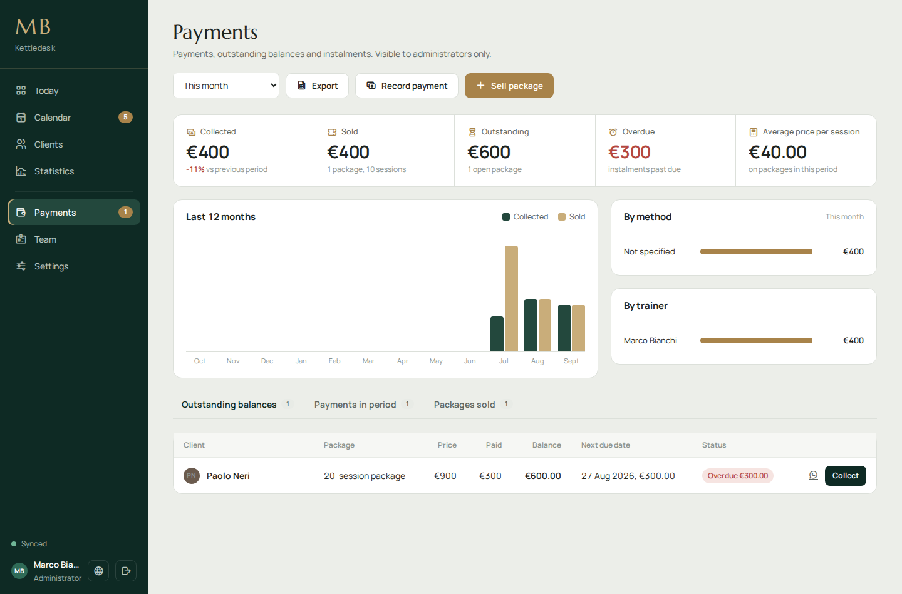

<div align="center">

# Kettledesk

**The studio app for personal trainers who book clients from their phone.**

Clients, appointments, packages, payments and workout programmes in one desktop app.
Google Calendar stays your diary; your data stays encrypted on your computer.

[](LICENSE)


**English** | [Italiano](README.it.md)



</div>

## Why it exists

Most personal-trainer software is built for online coaching: it wants a subscription, a server and your clients' data in someone else's cloud.
Kettledesk was built for a real studio with a different way of working:

- **Appointments are typed on the phone**, in Google Calendar, often with just a first name ("Anna"). The app works out who "Anna" is, asks once when it isn't sure, and remembers the answer.
- **Personal events stay out of the numbers.** The dentist, a dinner, a birthday: one click marks them as "not a workout" and they never reach the statistics.
- **Sessions come in packages.** Every attendance deducts a session; late cancellations can too. Packages can be paid in instalments, and overdue ones are flagged.
- **No server, no subscription.** It is a desktop app. Data lives on the studio PC, encrypted, with backups to a folder of your choice.

## Features

| | |
|---|---|
| **Calendar** | Week and list views on top of Google Calendar. Create, edit and delete appointments; works offline and syncs when the connection is back. |
| **Appointment recognition** | Matches titles to clients by full name, reversed name or saved nicknames. Unmatched titles go to a *To sort* inbox, grouped by name, so each one is fixed once. Recurring series can be linked in one go. |
| **Clients** | Profile, health issues with priority, notes, body measurements with charts, encrypted progress photos with side-by-side comparison, archive. |
| **Attendance** | Present, absent, late cancellation. Attendance deducts from the current package. |
| **Packages and payments** | Price list, sale with full payment, deposit or instalments (monthly or every two weeks), outstanding balances, overdue instalments, WhatsApp reminders, printable receipts, CSV export. |
| **Workout programmes** | Multi-day programmes with sets, reps, load, rest and technique notes. Reusable templates, printing with a four-week tracking grid, a workout log with last-time values pre-filled, progress charts per exercise. |
| **Statistics** | Hours, sessions, consistency, workout types, busiest days and hours, 12-month trend, clients to follow up, packages to renew, team comparison. |
| **Team** | Administrators and trainers. Trainers only see their own clients and appointments, never prices or payments. |
| **Languages** | English, Italiano, Deutsch, Français, Español, Português, 中文, Shqip. Dates, numbers and currency follow the selected language. |

## Screenshots

| | |
|---|---|
|  |  |
| Week view: recognised clients in the trainer's colour, dashed when a match needs confirming. | *To sort*: appointments grouped by title, linked once and remembered. |
|  |  |
| Programme, workout log and progress for an exercise. | Collected, sold, outstanding and overdue, with instalment tracking. |

## Getting started

### Requirements

- Windows 10 or 11
- [Node.js](https://nodejs.org) LTS (22 or 24), only to build the app
- A Google account and a free Google Cloud project

### Build

```bash
git clone https://github.com/Mariglend/kettledesk.git
cd kettledesk
npm install
npm start          # run in development
npm run build      # create dist/Kettledesk.exe (portable, no installer)
```

On Windows you can also double-click `BUILD.bat`. The first time Windows may show "Windows protected your PC", because the executable is not signed: choose *More info → Run anyway*.

<details>
<summary>Build troubleshooting</summary>

- **"Electron failed to install correctly"**: the Electron download was interrupted. Use Node LTS, make sure your antivirus is not blocking it, delete `node_modules\electron` and run `npm install` again.
- **"The process cannot access the file because it is being used by another process"**: an old copy of the app is still running, or the `dist` folder is locked. Close the app, or build to another folder: `npx electron-builder --win portable -c.directories.output=release`.

</details>

### Connect Google (once)

1. In [Google Cloud Console](https://console.cloud.google.com) create a project.
2. Under **APIs & Services → Library**, enable **Google Calendar API**.
3. Under **OAuth consent screen**, choose *External* and add the administrator's and trainers' emails as **Test users**.
4. Under **Credentials**, create an **OAuth client ID** of type **Desktop app**.
5. Start the app and paste the Client ID. The Client Secret is only needed for *Web application* clients.

The first account that signs in becomes the administrator. Other trainers are added under **Team**; only listed emails can sign in.
To see a trainer's appointments, the trainer shares their Google Calendar with the administrator ("Make changes to events") and the administrator enters that calendar's address in **Team**.

Set the studio name, currency and default phone prefix in **Settings → Studio**. The studio name appears in the menu, on the sign-in screen and on printouts.

## How appointments are recognised

Event titles look like `Name - Type`, for example `Anna Rossi - Strength`; the type is optional. An appointment is linked to a client when, in this order:

1. it was linked by hand, on the single event or on the whole recurring series;
2. it was created in the app, which stores the client in the event;
3. its title matches first and last name, last and first name, or one of the client's saved names;
4. its title is just a first or last name that fits exactly one client: then it is *suggested* and needs one click to confirm.

All-day events and titles marked as "not a workout" are ignored. Everything else lands in **Calendar → To sort**. Linking a title there saves it as a nickname for that client, so the next appointments link on their own. Renaming a client keeps the old name recognised.

## Data and privacy

- Data lives in `%APPDATA%\kettledesk\data\`, encrypted with Windows data protection (DPAPI, through Electron's `safeStorage`). Only the Windows user running the app can read it.
- Photos are stored as separate files, resized and encrypted.
- Google tokens and passwords are kept in the same encrypted store. Nothing leaves the computer except the calls to Google for sign-in and Calendar.
- The app is designed for one PC shared by the studio: everyone signs in with their own Google account and sees data according to their role.

The app stores health information about clients (issues, measurements, photos). If you use it, you are the data controller: inform your clients, get their consent where required (e.g. GDPR) and protect backups with a password.

## Backups

Under **Settings → Backup and security** choose a folder (OneDrive, Google Drive or a USB stick work well). The backup updates after every change and contains:

- `kettledesk-data.json`, the full data for restoring;
- `clienti.csv` and `pagamenti.csv` for Excel, without health data;
- `foto\` and one copy per day in `storico\`.

With a backup password the data file and photos are encrypted with AES-256-GCM. Without the password a backup cannot be restored.

## Languages

The interface is available in 8 languages. It follows the computer's language on first start and can be changed on the sign-in screen, with the globe button at the bottom of the sidebar, or in **Settings → Studio**.

Default workout types, payment methods and the exercise library are created in the language in use when the app is first set up; after that they are your data and can be renamed freely.

Translations live in [`js/i18n/`](js/i18n). Improvements and new languages are very welcome: see [CONTRIBUTING.md](CONTRIBUTING.md).

## Project structure

```
main.js          Electron main process: window, Google sign-in, encrypted store, backups
preload.js       bridge between Electron and the interface
index.html       page skeleton
css/app.css      styles
js/
  i18n.js        translation helpers and language list
  i18n/*.js      one file per language
  core.js        utilities, navigation, dialogs, formats
  store.js       data model, saving, packages and attendance
  google.js      sign-in, Google Calendar sync, offline queue
  events.js      appointment recognition and linking
  calendar.js    calendar and "To sort"
  clients.js     clients, measurements, photos, notes
  money.js       packages, payments, instalments, receipts
  programs.js    workout programmes, log, progress
  stats.js       statistics
  dashboard.js   "Today" page
  admin.js       team, settings, backups
  boot.js        startup
vendor/          fonts and icons, bundled so the app works offline
scripts/         translation checker
```

There is no framework and no build step for the interface: plain JavaScript files loaded in order by `index.html`. Code comments are in Italian.

## Known limitations

- Builds and tests target Windows. Electron runs on macOS and Linux, but the build configuration and the encrypted store have only been used on Windows.
- Google Calendar is required: there is no built-in calendar.
- One studio per installation, on one computer. There is no sync between computers other than restoring a backup.
- Receipts are not tax invoices.

## License

[MIT](LICENSE) © Mariglend Allushi.
Fonts ([Manrope](https://github.com/sharanda/manrope), [Marcellus](https://fonts.google.com/specimen/Marcellus)) are under the SIL Open Font License; icons are [Tabler Icons](https://tabler.io/icons) (MIT). See [vendor/LICENSES.md](vendor/LICENSES.md).
